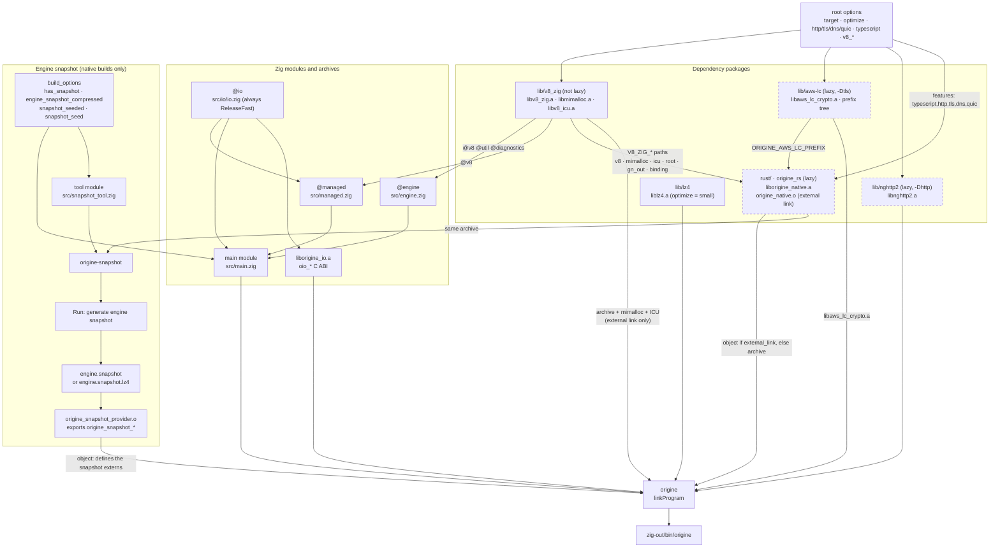
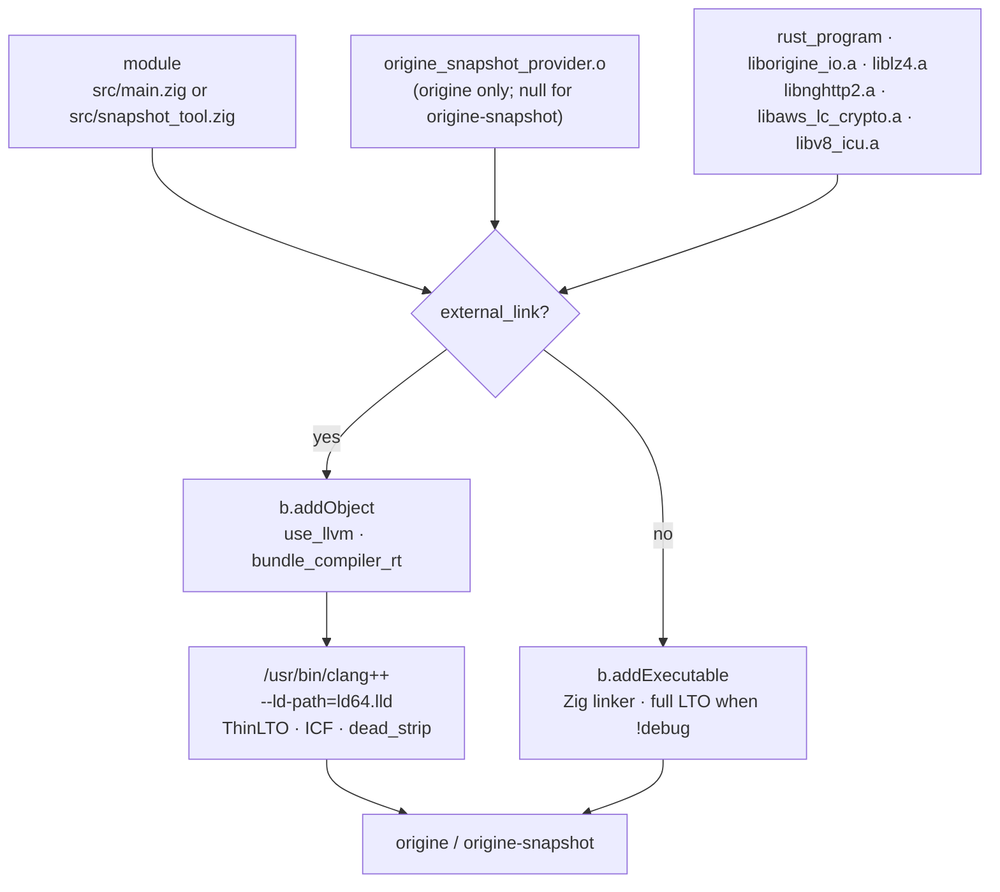

# Build graph

`build.zig` wires five packages into one demand-driven DAG. The root owns the final link and
the top-level steps; `lib/v8_zig`, `lib/aws-lc`, `lib/nghttp2`, `lib/lz4` and `rust/` are
separate packages whose outputs arrive as `LazyPath`s or `Step.Compile` artifacts. Nothing is
built eagerly: requesting a step builds only the nodes it reaches.

See [BUILD.md](BUILD.md) for the commands and options, and [contracts.md](contracts.md) for
the cross-language surfaces.

## Overall



The dashed nodes are `dependencyLazy` calls: on the first build the package is fetched and the
build is restarted, so the dependency is never half-configured.

**Why the Rust package has no edge back.** Every root-owned path the Rust build needs (the V8
archive, mimalloc, ICU, the checkout, GN's `compile_commands.json`, the bindings, the AWS-LC
prefix) is passed *into* `origine_rs` as a `LazyPath` option (`build.zig:97`,
`rust/build.zig`). The package owns cargo and the pre-link step; the root owns the final link.

**`external_link`** (`build.zig:10`) is `macOS && optimize != .debug`. It changes two edges:
the `@v8` module is built with `link_native = !external_link`, so it does not carry the V8
archive itself, and the Rust package returns the pre-linked `origine_native.o` instead of the
raw archive. Both exist to let V8's `ld64.lld` do the final link without duplicate Rust
runtime symbols; see [contracts.md](contracts.md), surface F.

## Linking



`linkProgram` (`build.zig:326`) is called twice: once for `origine`, with the provider object,
and once for `origine-snapshot`, with `provider = null`. The provider is attached like any
other link input: `link.addArtifactArg2(provider, .{})` before `rust_lib` in the external-link
path, `module.addObjectFile(provider.getEmittedBin())` in the Zig-linker path. The Rust
object/archive is attached to the module (`addObjectFile` on the module, `linkLibrary` for the
C archives) in the Zig-linker path, and passed as a file argument to `clang++` in the
external-link path.

Because the snapshot bytes live in their own object, `src/main.zig` is not an input of the
snapshot: the main object can compile while the snapshotter is built and run, and only the
link waits for the provider.

## Engine snapshot and the provider

```mermaid
flowchart LR
    bopts["build_options<br/>snapshot_seeded = optimize == .debug<br/>snapshot_seed = 0x3c3d6918"]
    toolmod["tool module<br/>src/snapshot_tool.zig<br/>@v8 · @engine · @managed · @lz4"]
    tool["origine-snapshot<br/>linkProgram(..., provider = null)"]
    run["Run: generate engine snapshot"]
    blob["engine.snapshot<br/>or engine.snapshot.lz4"]
    copy["WriteFiles<br/>engine.snapshot copy"]
    src["generated snapshot_provider.zig<br/>@embedFile(engine.snapshot)"]
    obj["origine_snapshot_provider.o<br/>b.addObject"]
    main["main module<br/>src/main.zig"]
    binary["origine"]

    bopts --> toolmod
    toolmod --> tool
    tool --> run
    run --> blob
    blob --> copy
    copy --> src
    src --> obj
    obj -->|"addArtifactArg2 / addObjectFile"| binary
    obj -.->|"satisfies externs at link"| main
    main --> binary
```



`src/main.zig` declares the blob instead of embedding it:

```zig
extern const origine_snapshot_present: bool;
extern const origine_snapshot_blob: [*]const u8;
extern const origine_snapshot_len: usize;
extern const origine_snapshot_compressed: bool;
```

`snapshotProvider` (`build.zig:290`) generates a module that `@embedFile`s the blob, exports
those four symbols, and compiles it as its own object. `origine` links that object, so the
shell's own compilation contains no copy of the blob and no `@embedFile` of a generated file.
This is what lets the shell object and the snapshotter compile in parallel.

Cross builds (`target.query.isNative()` false) skip the whole subgraph: no `origine-snapshot`,
no blob, no provider. `src/main.zig` still declares the four externs, so a cross build has
nothing to resolve them until a stub provider exporting `origine_snapshot_present = false` is
added.

## Caching

A `Run` step without side effects is cached on its declared inputs and outputs; one with side
effects runs every time. Two properties matter here:

- **Cargo.** `rust/build.zig` no longer marks the cargo step as having side effects. It
  declares the workspace manifests, `Cargo.lock` and the crate sources as file inputs
  (`cargoInputs`, `rust/build.zig:100`), and declares the archive itself with
  `cargo.addOutputFileArg2(...)` (`rust/build.zig:55`). A cache hit restores the archive from
  Zig's cache; no `WriteFiles.addCopyFile` sits between cargo and the link any more. Zig
  decides whether to invoke cargo at all; cargo still does incremental compilation inside the
  run.
- **Snapshot.** `Run: generate engine snapshot` declares `engine.snapshot` as an output file
  argument. Debug builds pass `--random-seed=0x3c3d6918 --predictable` from
  `src/snapshot_tool.zig` (`snapshot_seed` is the low 31 bits of `build.zig.zon`'s
  fingerprint), so an unchanged rebuild produces byte-identical bytes and the cache can hit.
  Release builds keep V8's random default seed on purpose: the blob changes on every build, so
  the generate step, the provider object and the `origine` link rerun.

Known gaps in the current tree:

- `snapshotProvider` writes the blob through `WriteFiles.addCopyFile` and the provider source
  through `WriteFiles.add`. `WriteFile` steps are not cacheable and rewrite their outputs on
  every build, so the provider's inputs churn even when the blob is byte-identical.
- `rust/build.zig` passes the V8 checkout (`V8_ZIG_V8_ROOT`) and the GN output directory
  (`V8_ZIG_GN_OUT`) with `addFileArg2`. The cargo step's cache check treats those arguments as
  files and fails with `file_read IsDir`; they need `addDirectoryArg2` with the `NAME=`
  prefix (directory inputs hash entry names, not file contents).

## Tests

`zig build test` is a second graph that shares the dependency packages but links differently:

- `test_v8` is a **second** V8 dependency with `link_native = true` when `external_link` is
  set, because the main one was configured for an external final link (`build.zig:202`).
- `src/tests.zig` links `liborigine_io.a`, lz4 and the native libs directly, and takes the
  plain Rust archive, not the pre-linked object (thread-locals break under pre-linking). It
  does not link the snapshot provider; nothing in the test graph restores the engine snapshot.
- It also depends on the `test` steps of the V8 and lz4 packages.

`zig build test-io` is a separate island: `src/io/io.zig` plus `src/safe.zig`, both without
V8, Rust or any of the native dependencies.

## Top-level steps

| Step | Reaches |
| --- | --- |
| (default `install`) | `origine` → `zig-out/bin/origine` |
| `build-shell` | the same install step |
| `run`, `shell` | `Run` over the `origine` binary, passthrough args, inherited stdio |
| `deps` | Rust `build`, mimalloc, `v8_icu`, the AWS-LC install step, lz4, nghttp2 |
| `build-v8`, `patch-v8` | forwarded to the V8 package's own steps; absent with `-Dv8_prebuilt_path` |
| `aws-lc-prefix` | the AWS-LC install step (the tree `just test-net` points cargo at) |
| `clippy`, `test-alloc` | forwarded to `origine_rs` |
| `test` | V8 package tests, lz4 tests, `src/tests.zig` |
| `test-io` | `src/io` and `src/safe.zig` only |

With `-Dquic` (which requires `-Dtls`) the AWS-LC package also builds `libaws_lc_ssl.a` and the
install step depends on it, but nothing links it yet: SSL is C++ and would need V8's libc++ at
the final link (`build.zig:135`).
