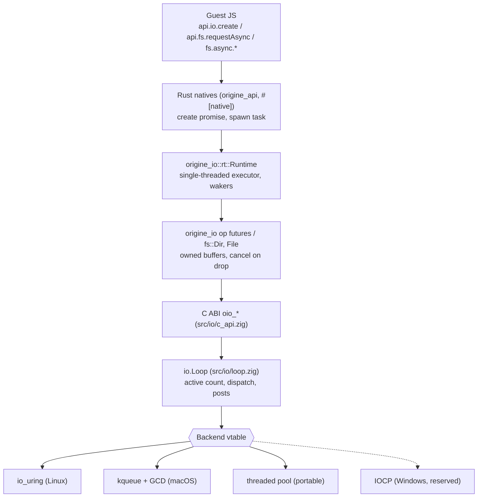
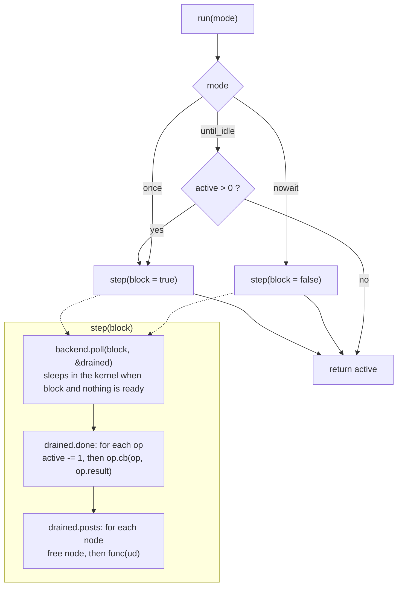
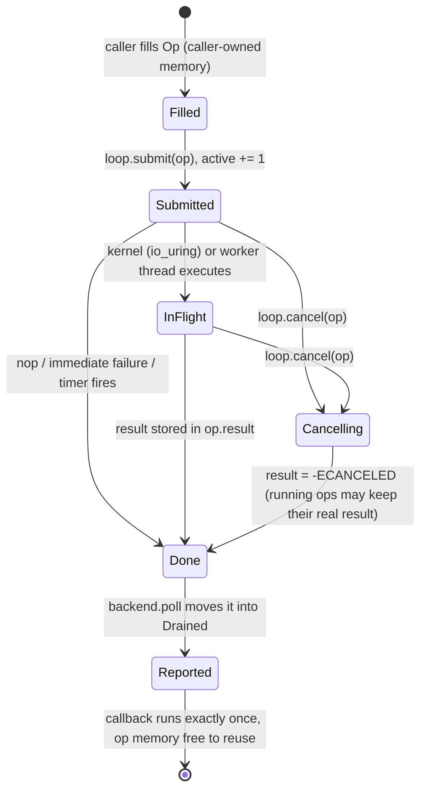
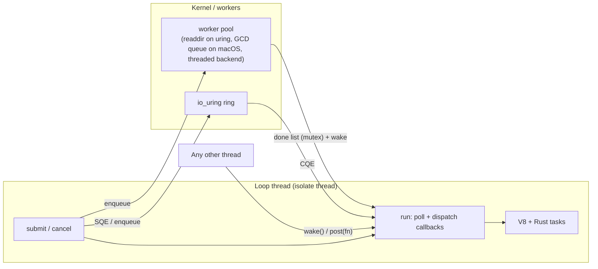
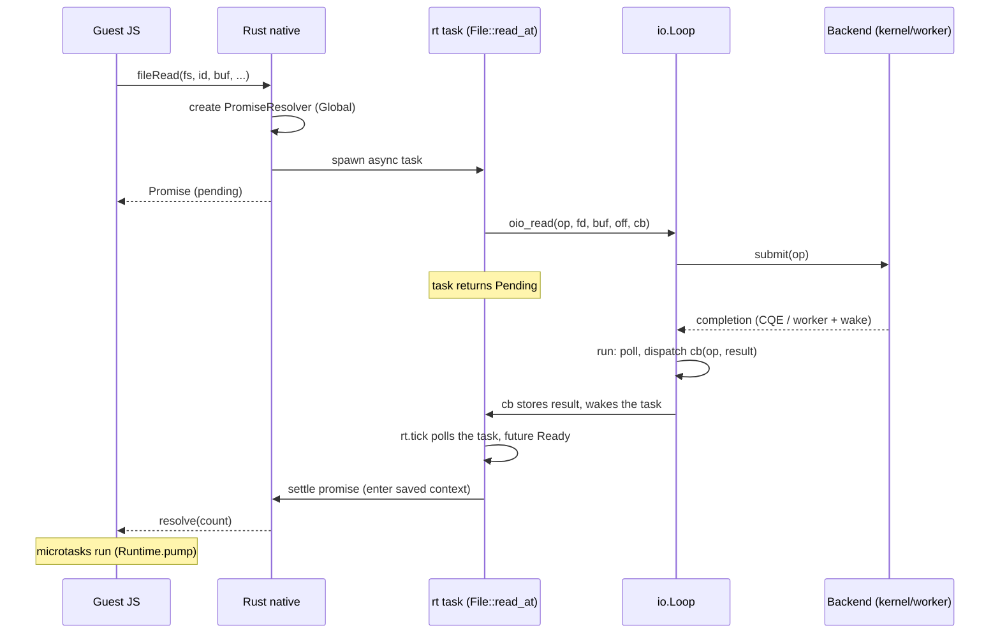
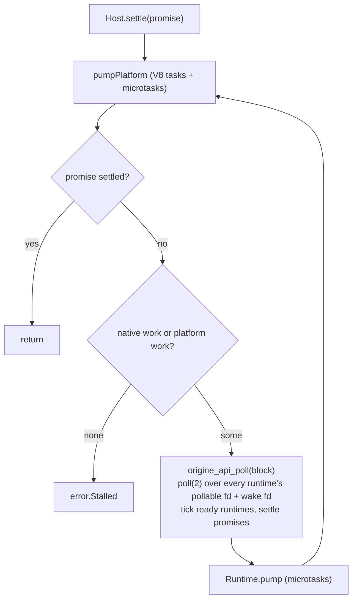

# Event loop diagrams

Mermaid diagrams of the loop (`src/io/loop.zig`), its backends and how the Rust runtime and the guest API sit on top.
Reference text: [ops](ops.md), [backends](backends.md), [C API](c-api.md); Rust side: [`origine_io` runtime](../../../rust/crates/origine_io/docs/rt.md).

## 1. Layers

Zig embedders use `io.Loop` directly; C and Rust callers go through the C ABI. Only the loop thread touches V8 and the runtime.

## 2. One turn of `Loop.run`

`poll` never runs callbacks. Callbacks and posted functions run only here, on the thread that called `run`, so a callback may submit more ops.

## 3. Op lifecycle

An op must stay alive and unmoved from `submit` until its callback has run. `Loop.destroy` cancels everything outstanding and runs those callbacks before freeing.

## 4. Threads

Only `wake` and `post` may be called from other threads. A worker never calls back into the loop or V8: it writes `op.result`, pushes the op on the done list and wakes the loop (eventfd, `EVFILT_USER`, or condvar plus self-pipe on the threaded backend; uring kernel work completes through the CQ instead).

## 5. An async read from JS (sequence)

## 6. Host `settle` (Zig side)

Several runtimes (one `Loop` + `rt::Runtime` each, created with `api.io.create`) share the isolate thread; the host waits on all of them at once through their `pollable()` fds. V8 platform tasks wake the wait through `origine_api_wake`.
